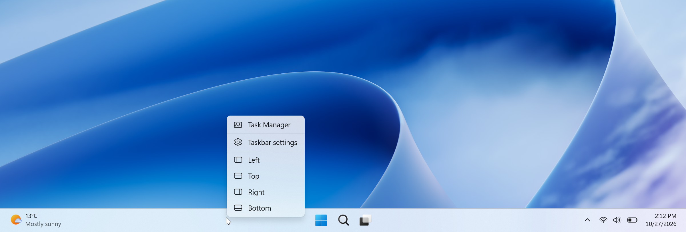

# Taskbar Location Options

Move the Windows 11 taskbar to any edge of the screen: pick **Left**, **Top**, **Right** or
**Bottom** from its right-click menu, or drag it with the mouse.

- **From the menu:** right-click an empty spot on the taskbar. Below *Taskbar settings* you'll see
  four new entries, each with an icon. Pick one and the taskbar moves to that edge.
- **With the mouse:** grab an empty spot on the taskbar and drag it to any edge of the screen.

## Requirements

✅ Windows 11 **26H2** (build **26300**) or newer  
✅ x64 or ARM64

## Installation

### 1. Trust the certificate (one time only)

The app is currently signed with a self-signed certificate, so Windows has to trust it once before
installing.

1. Download [Install-Certificate.ps1](https://github.com/michalleptuch/TaskbarLocationOptions/releases/latest/download/Install-Certificate.ps1).
2. **Unblock the file first** - Windows blocks scripts downloaded from the internet, and without this
   step the script window just flashes and closes. Right-click the file → **Properties** → at the
   bottom of the *General* tab check **Unblock** → **OK**.
3. Right-click the file → **Run with PowerShell** (on Windows 11 it may be under
   **Show more options**) and confirm the administrator prompt.

The script downloads
[TaskbarLocationOptions.cer](https://github.com/michalleptuch/TaskbarLocationOptions/releases/latest/download/TaskbarLocationOptions.cer)
from the latest release and adds it to *Local Machine → Trusted People*. Wait for the green
*Success* message, then press Enter.

Prefer to do it manually?

1. Download [TaskbarLocationOptions.cer](https://github.com/michalleptuch/TaskbarLocationOptions/releases/latest/download/TaskbarLocationOptions.cer).
2. Double-click it → **Install Certificate…**
3. Choose **Local Machine** → **Next** (confirm the administrator prompt).
4. Choose **Place all certificates in the following store** → **Browse…** → **Trusted People** →
   **OK** → **Next** → **Finish**.

### 2. Install the app

Download the installer for your architecture and open it:

| Architecture | Installer |
|---|---|
| x64 | [TaskbarLocationOptions_x64.appinstaller](https://github.com/michalleptuch/TaskbarLocationOptions/releases/latest/download/TaskbarLocationOptions_x64.appinstaller) |
| ARM64 | [TaskbarLocationOptions_arm64.appinstaller](https://github.com/michalleptuch/TaskbarLocationOptions/releases/latest/download/TaskbarLocationOptions_arm64.appinstaller) |

Click **Install**. Required components are installed automatically, and the app keeps itself up to
date in the background.

## Uninstalling

Use the **Uninstall** button in the app window. The app closes, Explorer restarts once (open File
Explorer windows close), and the package is removed along with all its files.

You can also uninstall it from *Settings → Apps → Installed apps*. Explorer doesn't restart in that
case, so a leftover file may remain in the app's data folder until you sign out or restart.

## How it works

Windows 11 doesn't offer a way to add items to the taskbar's context menu, so the app adds the four
entries to it. Clicking an entry writes the standard taskbar location value in the registry
(`HKCU\Software\Microsoft\Windows\CurrentVersion\Explorer\Advanced\TaskbarLocation`). Nothing else
in the system is changed.

> [!WARNING]
> The app depends on how Explorer works internally, and a Windows update may change that.
> If the entries stop showing up after an update, please open an issue.

## Feedback

Bugs and suggestions are welcome in [Issues](https://github.com/michalleptuch/TaskbarLocationOptions/issues).
